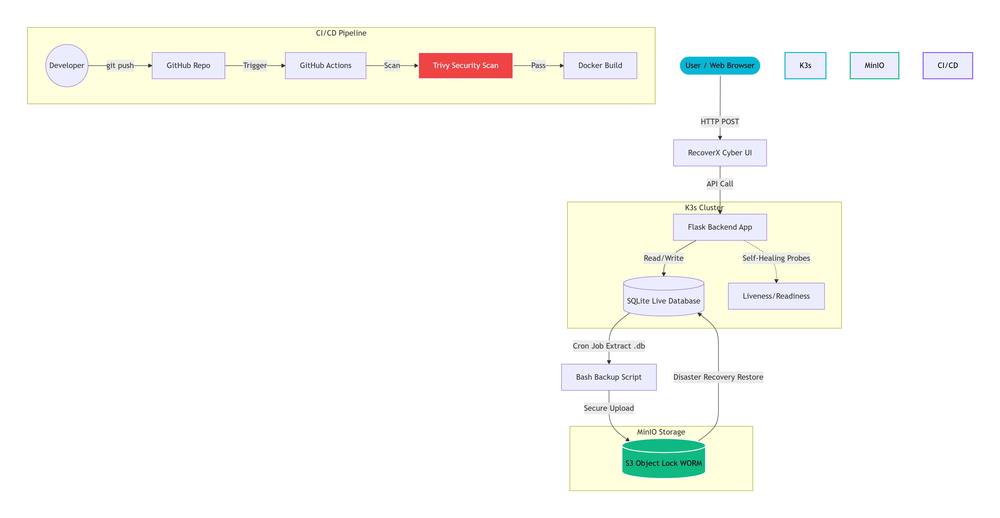
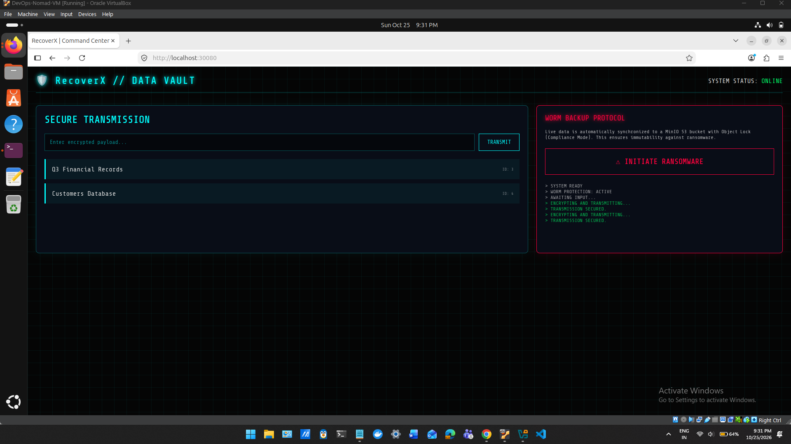
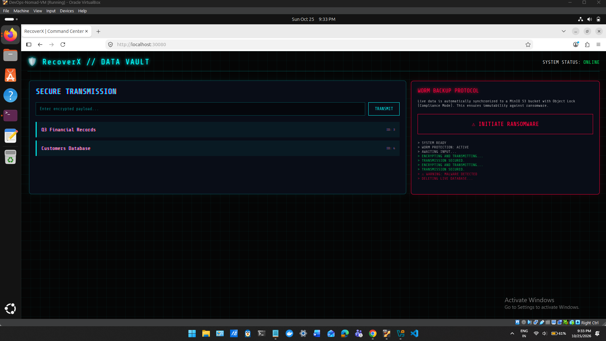
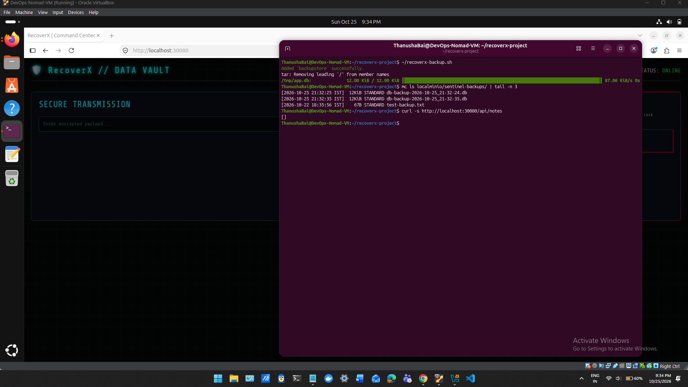
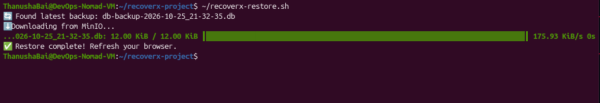
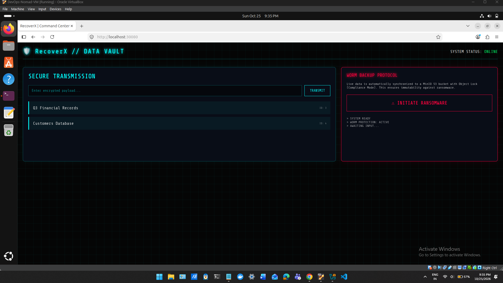
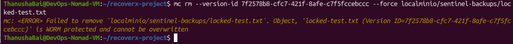

# 🛡️ RecoverX: Cloud-Native Data Resilience Platform

**Immutable Protection. Verified Recovery.**

RecoverX is a full-stack, stateful application deployed on a lightweight Kubernetes (K3s) cluster. It features an interactive Cybersecurity Command Center that allows engineers to simulate ransomware attacks and demonstrate real-time, automated disaster recovery using MinIO S3 Object Lock (WORM).

## 🚀 Key Features
- **Full-Stack Application:** Python (Flask) backend with a SQLite database, serving a custom vanilla JS/CSS cyber-security dashboard.
- **Immutable Backups (WORM):** Automated backups are uploaded to a MinIO bucket configured with **S3 Object Lock (Compliance Mode)**. Even a root administrator cannot delete these backups during the retention period.
- **Disaster Recovery (DR) Simulation:** A built-in "Ransomware Simulator" wipes the live database on command. A recovery script then pulls the immutable backup from MinIO and restores the state in under 10 seconds.
- **Self-Healing Infrastructure:** Deployed on K3s with Liveness and Readiness probes. If the app crashes, Kubernetes automatically spins up a new pod.
- **Secure CI/CD Pipeline:** GitHub Actions automates the build process and uses Trivy to scan for vulnerabilities. The pipeline blocks deployments if HIGH/CRITICAL CVEs are found.

## 🏗️ Architecture

---

## 📸 Proof of Concept (Disaster Recovery Drill)

Here is the step-by-step execution of a simulated ransomware attack and recovery:

### 1. Live Data Transmission
The user enters critical data into the RecoverX Command Center.

### 2. Ransomware Attack Executed
The user clicks "Initiate Ransomware". The UI glitches as the backend executes a `DELETE` query on the live database.

### 3. Database Wiped (Proof)
The API confirms the live database is completely empty (`[]`), simulating total data loss.

### 4. Automated Recovery
The SRE runs the restore script, which pulls the latest `.db` file from the immutable MinIO vault and injects it back into the Kubernetes pod.

### 5. Data Recovered
The browser is refreshed, and all data is successfully restored (RTO < 10 seconds).

### 6. WORM Protection (Immutability Proof)
An attempt to force-delete the backup fails with a hard `WORM protected` error, proving immunity to ransomware.

---

## 🛠️ Tech Stack
**Backend:** Python, Flask, SQLite  
**Frontend:** HTML, CSS, Vanilla JavaScript  
**Infrastructure:** Docker, Kubernetes (K3s), MinIO (S3 Object Lock)  
**CI/CD & Security:** GitHub Actions, Trivy

---
## 💡 Project Impact & Lessons Learned

Building RecoverX taught me that **backups are not a backup until they are tested.** 

In a real-world scenario, a backup that is easily accessible to an attacker is useless. By implementing **WORM (Write Once Read Many)** compliance, I ensured that even if an attacker gains root access, the recovery path remains secure. 

Furthermore, this project highlighted the importance of minimizing the **Recovery Time Objective (RTO)**. By testing the disaster drill live, I observed that the restore process (pulling from MinIO and injecting back into the pod) took only a matter of seconds. Combining Kubernetes self-healing, automated CI/CD pipelines, and immutable storage proves that a zero-cost, open-source stack can achieve enterprise-grade disaster recovery.
